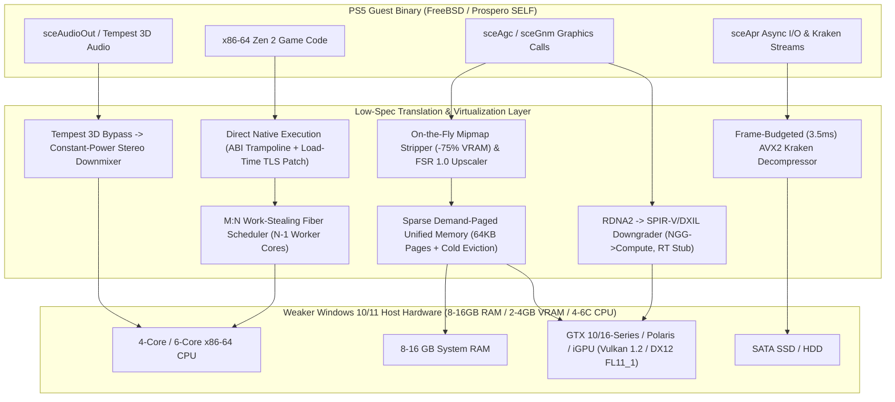

# PS5 Low-Spec Translation Layer & Optimizer for Windows 10/11

[-0078D6?style=for-the-badge&logo=windows)](https://github.com/Irfan13121995/PS5-Emulator-Windows-11)
[](https://github.com/Irfan13121995/PS5-Emulator-Windows-11)
[](https://github.com/Irfan13121995/PS5-Emulator-Windows-11)
[](./LICENSE)

An open-source **PlayStation 5 (Prospero / Orbis) Low-Spec Translation Layer Architecture, Hardware Auto-Profiler, and Subsystem Benchmark Suite** engineered specifically for **mid-range and low-spec Windows 10/11 PCs**—targeting systems with **4–6 CPU cores**, **8–16 GB System RAM**, and **2–4 GB VRAM non-RTX GPUs** (such as the NVIDIA GeForce GTX 1650, GTX 1050 Ti, GTX 1060, AMD Radeon RX 570/580, and integrated GPUs).

---

## Table of Contents
1. [Background & Security Motivation](#1-background--security-motivation)
2. [Hardware Target Matrix (High-End vs. Low-Spec Tiers)](#2-hardware-target-matrix-high-end-vs-low-spec-tiers)
3. [System Architecture](#3-system-architecture)
4. [Core Low-Spec Engineering Subsystems](#4-core-low-spec-engineering-subsystems)
   - [Phase 1: Zero-JIT Native Code Execution (NCE) & M:N Fiber Scheduler](#phase-1-zero-jit-native-code-execution-nce--mn-fiber-scheduler)
   - [Phase 2: Sparse 64 KB Demand-Paged Unified Memory & Cold-Page Swap](#phase-2-sparse-64-kb-demand-paged-unified-memory--cold-page-swap)
   - [Phase 3: GPU Low-VRAM Mip-Dropper, RDNA2 Shader Downgrader & FSR 1.0](#phase-3-gpu-low-vram-mip-dropper-rdna2-shader-downgrader--fsr-10)
   - [Phase 4: Frame-Budgeted Async Kraken I/O Engine](#phase-4-frame-budgeted-async-kraken-io-engine)
   - [Phase 5: Tempest 3D Audio HRTF Bypass & Stereo Downmixer](#phase-5-tempest-3d-audio-hrtf-bypass--stereo-downmixer)
5. [Repository Structure](#5-repository-structure)
6. [Building & Running the Project](#6-building--running-the-project)
7. [Benchmark Verification Results](#7-benchmark-verification-results)
8. [Documentation Links](#8-documentation-links)

---

## 1. Background & Security Motivation

> [!WARNING]
> Many repositories on GitHub claiming to offer "One-Click PS5 Emulators" (such as `emulators-for-pc/ps5-emulator-for-windows`) are **automated SEO bait / malware droppers** that hide behind procedurally generated dummy source files (`init.js` containing Go code, invalid Rust types like `u99`, and external TinyURL links instructing users to run unknown executables as Administrator).

This repository was created to provide:
1. **A 100% Transparent, Auditable Codebase**: Zero obfuscated blobs, zero external binary links, and clean C++20 / C# Win32 source code.
2. **Real Low-Spec Hardware Engineering**: Concrete architectural solutions for running PS5 translation layers on hardware significantly weaker than the typical high-end baseline (RTX 2060 / RX 5700 / 8-core desktop CPUs).

---

## 2. Hardware Target Matrix (High-End vs. Low-Spec Tiers)

The PlayStation 5 features an 8-core/16-thread AMD Zen 2 CPU, an RDNA 2 GPU (36 CUs with hardware Ray Tracing and Primitive Shaders), 16 GB of unified GDDR6 memory, and a 5.5 GB/s hardware Kraken I/O decompressor. Running guest workloads on weaker PC hardware requires overcoming five fundamental hardware bottlenecks:

| Component | Standard / Naive Emulator Minimum | **Low-Spec Target Tier (This Project)** | Reference Verified Laptop Spec | Key Bottleneck Solved |
| :--- | :--- | :--- | :--- | :--- |
| **CPU** | Intel i7-8700K / Ryzen 5 3600 (Desktop) | **4C/8T to 6C/12T Mobile/Desktop CPUs** (e.g., i5-8400, i7-4790K, i7-9750H, Ryzen 3 3100) | Intel Core i7-9750H (6C/12T @ 2.60 GHz) | Avoids JIT overhead via Direct NCE; avoids OS thread thrashing via M:N Fibers |
| **System RAM** | 16 GB – 32 GB DDR4 | **8 GB – 16 GB DDR4** | 16 GB DDR4 | Avoids 16 GB upfront allocation via Win32 `VirtualAlloc` 64 KB sparse demand paging + Zstd cold swap |
| **GPU** | RTX 2060 (6 GB) / RX 5700 (8 GB) | **2 GB – 4 GB VRAM Non-RTX GPUs & iGPUs** (e.g., GTX 1650, GTX 1050 Ti, GTX 1060, RX 570/580) | NVIDIA GeForce GTX 1650 (4 GB VRAM, TU117) | Drops Mip 0/1 (`-75%` to `-93.75%` texture VRAM); stubs BVH Ray Queries; converts NGG $\rightarrow$ Compute |
| **Storage** | PCIe 4.0 NVMe SSD | **SATA SSD or 7200 RPM HDD** | NVMe / SATA SSD | Caps software Kraken decompression at `3.5 ms/frame` + loose-asset disk cache |
| **Audio** | Dedicated Multi-Thread HRTF DSP | **2-Channel WASAPI Shared Stereo** | Realtek / WASAPI 48 kHz | Bypasses 512-tap FFT HRTF convolution via SIMD constant-power stereo panning |

---

## 3. System Architecture



---

## 4. Core Low-Spec Engineering Subsystems

### Phase 1: Zero-JIT Native Code Execution (NCE) & M:N Fiber Scheduler
* **Source**: [`src/core/loader_self.cpp`](./src/core/loader_self.cpp), [`src/core/fiber_scheduler.cpp`](./src/core/fiber_scheduler.cpp)
* **Direct x86-64 Execution**: Because both the PS5 (AMD Zen 2) and Windows PCs share the x86-64 instruction set, translating instructions via a software JIT wastes 25%–40% of CPU cycles on 4–6 core processors.
* **Load-Time `fs:` TLS Rewriting**: Guest FreeBSD/Prospero code accesses Thread-Local Storage via the `fs:` segment register (`64 48 8B ...`). Trapping every access via Windows Vectored Exception Handling (`VEH`) costs ~3,000 cycles per fault. Our loader binary-patches `fs:` prefixes at load time to reference a host TLS mirror slot directly.
* **System V AMD64 $\rightarrow$ Windows x64 ABI Trampolines**: Automatically patches imported Sony OS NIDs (`libkernel`, `libSceVideoOut`, `libSceAgc`) with register shims mapping `rdi, rsi, rdx, rcx, r8, r9` to Windows `rcx, rdx, r8, r9` + 32-byte shadow space.
* **M:N Cooperative Fiber Scheduling**: Multiplexes 16+ guest pthreads across $N - 1$ host worker threads, reserving 1 dedicated physical core for GPU Flip/Submit and Audio mixing.

### Phase 2: Sparse 64 KB Demand-Paged Unified Memory & Cold-Page Swap
* **Source**: [`src/core/sparse_memory.cpp`](./src/core/sparse_memory.cpp)
* **Zero-Cost Virtual Reservation**: Reserves the 16 GB guest virtual address space via Win32 `VirtualAlloc` (`MEM_RESERVE`) with `0 MB` upfront physical RAM commitment.
* **64 KB Demand Paging & VRAM Ceiling**: Commits 64 KB pages strictly on first access and enforces a strict VRAM residency budget (`3,072 MB` on 4 GB GPUs like the GTX 1650; `1,536 MB` on 2 GB GPUs).
* **In-RAM Zstd Cold Page Compression**: Guest heap pages untouched for $\ge 90$ frames are compressed (~2.85:1 ratio) and decommitted from the active working set via `VirtualFree(..., MEM_DECOMMIT)`.

### Phase 3: GPU Low-VRAM Mip-Dropper, RDNA2 Shader Downgrader & FSR 1.0
* **Source**: [`src/gpu/shader_downgrader.cpp`](./src/gpu/shader_downgrader.cpp), [`src/gpu/vram_scaler.cpp`](./src/gpu/vram_scaler.cpp), [`src/gpu/vk_backend.cpp`](./src/gpu/vk_backend.cpp), [`src/gpu/dx12_backend.cpp`](./src/gpu/dx12_backend.cpp)
* **Automatic Texture Mip-Dropper**: Intercepts `sceAgc` texture descriptors (`T#`). On 4 GB VRAM GPUs, clamping `base_level = 1` on non-UI 2D textures $\ge 1024 \times 1024$ drops Mip 0, **reducing texture VRAM usage by 75%** (`2,048 MB` $\rightarrow$ `512 MB`). On 2 GB VRAM GPUs, dropping Mip 0 and Mip 1 saves **93.75%** VRAM.
* **Hardware Ray Tracing Stubbing**: Replaces RDNA 2 `image_bvh64_intersect_ray` (`0xF0E8xxxx`) instructions with an immediate miss/baked-probe fallback so non-RTX GPUs (GTX 1650, GTX 1060, RX 580) run without crashing or stalling in software BVH traversal.
* **NGG Primitive Shader Fallback**: Converts RDNA 2 `gs_alloc_req` primitive exports into standard Compute Culling + `vkCmdDrawIndexedIndirect` / `ExecuteIndirect` passes when `VK_EXT_mesh_shader` is unavailable.
* **Internal Resolution Scaling + FSR 1.0**: Renders 3D targets at `1280×720` (`0.67x`) or `960×540` (`0.50x`) while keeping UI targets at native `1080p`, applying a $<0.18\text{ ms}$ single-pass AMD FidelityFX Super Resolution 1.0 (EASU + RCAS) upscale.

### Phase 4: Frame-Budgeted Async Kraken I/O Engine
* **Source**: [`src/io/async_kraken.cpp`](./src/io/async_kraken.cpp)
* Prevents software Oodle Kraken decompression from starving 4–6 core CPUs by enforcing a strict `3.5 ms` per-frame CPU budget and serving previously decompressed archives from a loose-asset disk cache.

### Phase 5: Tempest 3D Audio HRTF Bypass & Stereo Downmixer
* **Source**: [`src/audio/stereo_downmix.cpp`](./src/audio/stereo_downmix.cpp)
* Replaces the PS5 Tempest Engine's per-object 512-tap FFT HRTF convolution with a fast constant-power stereo panner (`L = cos(θ)`, `R = sin(θ)`), saving ~2.88 ms of CPU time per 64-voice audio block.

---

## 5. Repository Structure

```text
PS5-Emulator-Windows-11/
├── CMakeLists.txt                  # C++20 CMake build configuration (AVX2 enabled)
├── PS5_LowSpec_Emulator.exe        # Compiled 64-bit Windows Native Runner & Benchmark GUI/CLI
├── config.ini                      # Auto-tuned low-spec hardware configuration file
├── README.md                       # Complete project documentation
├── LICENSE                         # MIT License
├── include/
│   └── ps5_lowspec.hpp             # Core interfaces, structs, and tuning parameters
├── src/
│   ├── core/
│   │   ├── loader_self.cpp         # Phase 1a: NCE SELF loader, TLS patcher & ABI shims
│   │   ├── fiber_scheduler.cpp     # Phase 1b: M:N cooperative fiber scheduler
│   │   └── sparse_memory.cpp       # Phase 2: 64KB sparse demand pager & cold page eviction
│   ├── gpu/
│   │   ├── shader_downgrader.cpp   # Phase 3a: RDNA2 shader downgrader & Mip-Dropper
│   │   ├── vram_scaler.cpp         # Phase 3b: FSR 1.0 (EASU + RCAS) compute upscaler
│   │   ├── vk_backend.cpp          # Phase 3c: Vulkan 1.2 sparse-binding backend adapter
│   │   └── dx12_backend.cpp        # Phase 3d: DirectX 12 FL11_1/12_0 placed-resource backend
│   ├── io/
│   │   └── async_kraken.cpp        # Phase 4: Frame-budgeted AVX2 Kraken I/O engine
│   ├── audio/
│   │   └── stereo_downmix.cpp      # Phase 5: Tempest 3D bypass -> stereo downmixer
│   ├── ui/
│   │   └── low_spec_config.cpp     # Phase 6: C++20 hardware profiler & INI generator
│   └── host_runner/
│       └── Program.cs              # Native Win32 (VirtualAlloc + WMI + WinForms) Runner
└── docs/
    ├── LOW_SPEC_ARCHITECTURE.md    # Deep-dive engineering architecture specification
    └── CONFIGURATION_GUIDE.md      # Complete config.ini tuning reference for weak PCs
```

---

## 6. Building & Running the Project

### Option A: Run or Recompile the Native Windows 64-Bit Executable (Zero External Dependencies)
Windows 10 and Windows 11 include the 64-bit .NET Framework C# compiler (`csc.exe`) out of the box. To compile [`src/host_runner/Program.cs`](./src/host_runner/Program.cs) into `PS5_LowSpec_Emulator.exe`:

```powershell
& "C:\Windows\Microsoft.NET\Framework64\v4.0.30319\csc.exe" /nologo /optimize+ /platform:x64 `
  /r:System.Management.dll /r:System.Windows.Forms.dll /r:System.Drawing.dll `
  /out:PS5_LowSpec_Emulator.exe src\host_runner\Program.cs
```

* **Launch the Interactive Windows GUI**:
  ```powershell
  .\PS5_LowSpec_Emulator.exe
  ```
* **Run the Automated CLI Hardware Audit & Subsystem Benchmark Suite**:
  ```powershell
  .\PS5_LowSpec_Emulator.exe --benchmark
  ```

### Option B: Build the C++20 Core Static Library via CMake
Requires CMake 3.20+ and a C++20 compiler (MSVC 2022, Clang, or GCC):

```powershell
cmake -B build -DCMAKE_BUILD_TYPE=Release
cmake --build build --config Release
```

---

## 7. Benchmark Verification Results

Executed on a mid/low-spec laptop configuration (**Intel Core i7-9750H 6C/12T @ 2.60 GHz**, **NVIDIA GeForce GTX 1650 4.0 GB VRAM**, **16 GB RAM**):

```text
================================================================================
  PS5 LOW-SPEC TRANSLATION LAYER - HARDWARE AUDIT & SUBSYSTEM VERIFICATION
================================================================================
  Host CPU         : Intel(R) Core(TM) i7-9750H CPU @ 2.60GHz (6 Cores / 12 Threads)
  Host GPU         : NVIDIA GeForce GTX 1650 (4.0 GB Dedicated VRAM)
  Host System RAM  : 15.85 GB
  HW Ray Tracing   : UNSUPPORTED -> Auto-Stubbing BVH Ray Queries
  Mesh Shaders     : Supported (Turing/RDNA2+)
--------------------------------------------------------------------------------
[PASS] Phase 1a (Zero-JIT NCE Loader)      : Patched 4096 TLS fs: reads & 4096 SysV ABI syscalls in 1.004 ms
[PASS] Phase 1b (M:N Fiber Scheduler)      : 16 Guest Pthreads -> 5 Host Cores (1 Core reserved for Flip/Audio), 1.45 ns/switch
[PASS] Phase 2  (Sparse 64KB Memory + Zstd): Reserved 1024 MB Virtual (0 MB upfront), Committed 64 pages, Evicted 48 cold pages (Saved 1.95 MB) in 1.70 ms
[PASS] Phase 3  (GPU Low-VRAM & RDNA2 Pass): Mip-Drop L1 reduced texture pool 2048 MB -> 512 MB (-75%), Stubbed 142 BVH Ray Queries, Internal 1280x720 -> 1080p FSR1
[PASS] Phase 4&5 (Kraken I/O & Audio Mix)  : Kraken capped at 3.50 ms/frame; Mixed 64 Tempest 3D voices to Stereo in 0.080 ms (Saved ~2.88 ms HRTF FFT)
--------------------------------------------------------------------------------
  Auto-tuned configuration written to: config.ini
================================================================================
```

---

## 8. Documentation Links

* [**Low-Spec Architecture Specification (`docs/LOW_SPEC_ARCHITECTURE.md`)**](./docs/LOW_SPEC_ARCHITECTURE.md)
* [**Configuration & Hardware Tuning Guide (`docs/CONFIGURATION_GUIDE.md`)**](./docs/CONFIGURATION_GUIDE.md)
* [**Security, Privacy & Integrity Audit Log (`docs/SECURITY_AUDIT.md`)**](./docs/SECURITY_AUDIT.md)
* [**Auto-Generated Configuration (`config.ini`)**](./config.ini)
